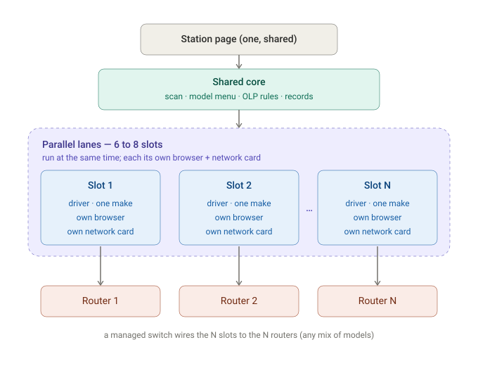
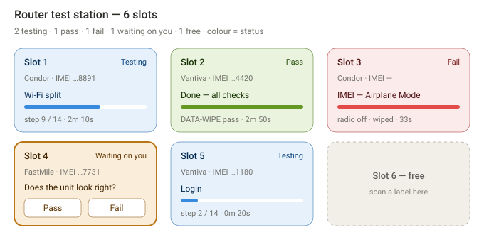

# Multi-slot station — design idea (2026-11-19)

Test 6 or 8 routers at once. Only a design sketch so far; nothing built. The core
is already shaped for it: `Lane` in `routertest/drivers/base.py` says "six slots
later are six lanes, each with its own browser and network card".

## Architecture



```
            ┌───────────────────────────┐
            │  Station page (one, shared) │
            └─────────────┬─────────────┘
                          │
            ┌─────────────▼─────────────┐
            │        Shared core         │
            │ scan · model menu · OLP    │
            │ rules · records            │
            └─────────────┬─────────────┘
                          │  (fans out to the lanes)
   ┌──────────┬───────────┼───────────┬──────────┐
   ▼          ▼           ▼           ▼          ▼
 Slot 1     Slot 2      Slot 3  ...  Slot N   (6 to 8, run at the same time)
 driver     driver      driver       driver
 own        own         own          own       each: its own browser
 browser    browser     browser      browser         + its own network card
 own NIC    own NIC     own NIC      own NIC
   │          │           │           │          │
   └──────────┴─── managed switch ────┴──────────┘
   ▼          ▼           ▼           ▼          ▼
 Router 1   Router 2    Router 3     Router N   (any mix of models)
```

- **Shared, one each:** the web page, the scan reader, the model menu, the OLP
  rules, the records writer.
- **Per lane (slot):** a driver (one make), its own Playwright browser context,
  its own network card. A managed switch wires the N slots to the N routers.
- Nothing in the core changes — it already takes a `Lane`. Six/eight lanes run in
  parallel instead of one.

## UI — the station page with slots



A grid of slot cards. The operator scans a label and it goes to the next free slot.
**Each card is coloured by its status** — blue = testing, green = pass, red = fail,
amber = waiting on you, gray = free — so the operator reads the whole bench at a
glance.

- **Top bar:** title, a scan box ("scan a label -> next free slot"), and a one-line
  summary ("2 testing, 1 pass, 1 fail, 1 waiting on you, 1 free").
- **Each slot card:**
  - header: `Slot N · model` + a status pill (Testing / Pass / Fail / Waiting on
    you / Free),
  - the unit (model · IMEI),
  - the current step + a thin progress bar ("Wi-Fi split · step 9/14"),
  - the result line ("DATA-WIPE pass · 2m 50s", or "IMEI — Airplane Mode").
- **Waiting on you:** a slot that needs the operator (the Visual question) gets an
  amber border and Pass / Fail buttons right on the card — only that slot.
- **Free slot:** a dashed card, "scan a label here".

So the operator sees at a glance which slot is doing what, which one needs them,
and where to put the next unit.

## Per-slot live view

Each card has a **View page** button. It opens that lane's live router page below —
address bar with the slot's IP (10.0.0.1 etc.), a red "live" dot, and a "read-only"
label. This is cheap: each `BrowserSession` already captures live frames
(`keep_frames`, JPEG). For N lanes, each has its own frame buffer; the page just
asks for "the frame of slot N". A click on the view (`click_view`) can be per-slot
too, if the operator wants to do something by hand on one unit.

## Per-slot log

- **Files:** each lane writes its own log, `reports/run-slot1-…-log.txt`,
  `run-slot3-…`, etc. (the station already saves one log per run; just add the
  slot number to the name). No two lanes write the same file.
- **In the page:** showing all 6-8 logs at once is noise. Each slot card shows only
  its **latest line**. The full log sits behind the slot's View panel, as a **Log**
  tab next to the Router page tab. The operator opens the one they care about.
- A failed slot shows its reason in the latest line ("radio off — failing, data
  wiped"); the full detail is one tab away.

## Open questions for later

- How many slots the PC can really drive at once (browsers + network cards + CPU).
- Managed switch vs. several USB network adapters.
- One scanner for all slots, or one per slot.
